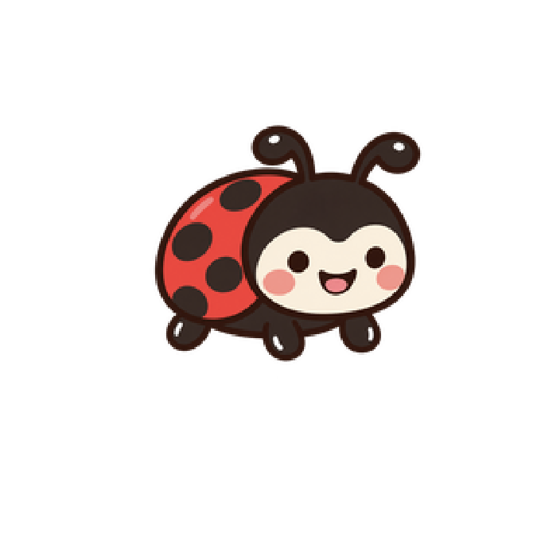
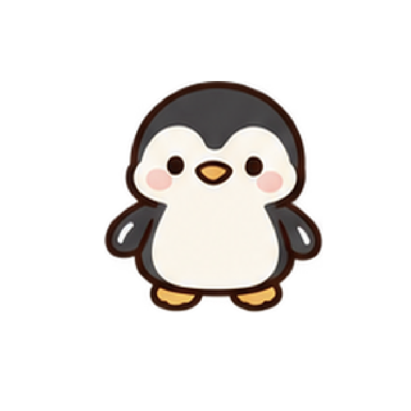

# Orca Dad Joke Pets

English | [日本語](README.ja.md)

An unofficial community collection of cute animated pets for [Orca ADE](https://www.onorca.dev/), with a dad joke for every companion.

This project is not affiliated with or endorsed by Orca ADE or its developers.

| 🐋 Orca | 🐬 Dolphin |
|:---:|:---:|
| [](pets/orca/README.md) | [](pets/dolphin/README.md) |
| 🐞 Ladybug | 🐧 Penguin |
| [](pets/ladybug/README.md) | [](pets/penguin/README.md) |

## Meet the pets

| Pet       | The joke                                                   | Details                           |
| --------- | ---------------------------------------------------------- | --------------------------------- |
| Orca 🐋    | “Orca ni orca wa oru ka?” — “Is there an orca in Orca?”    | [Orca](pets/orca/README.md)       |
| Dolphin 🐬 | “Orca ni iruka wa iru ka?” — “Is there a dolphin in Orca?” | [Dolphin](pets/dolphin/README.md) |
| Ladybug 🐞 | “There's a bug in Orca! Don't fix it. It's my pet!”        | [Ladybug](pets/ladybug/README.md) |
| Penguin 🐧 | “Status: PENGUIN! Oops, I mean PENDING...”                 | [Penguin](pets/penguin/README.md) |

The first two jokes play on Japanese sounds. **Orca** is written as オルカ (oruka) in Japanese, which sounds like おるか？ (oru ka?), a casual, regional way of asking "Is it there?". **Iruka** (イルカ) means "dolphin" and sounds exactly like いるか？ (iru ka?), another way to ask "Is it there?". The individual pet pages explain these jokes in more detail.

**Ladybug** turns a software "bug" into an adorable insect companion — one you wouldn't want to fix!

**Penguin** playfully mixes up **Pending** and **Penguin** as a silly status message. It's invented wordplay, not a conventional English expression.

## Installation

Use Orca's **Import .codex-pet bundle…** menu to import one of the folders below. You need an Orca build with the experimental **Pet** feature and bundle import support.

Follow the [installation guide](docs/INSTALLATION.md) for download steps, the exact menu path, troubleshooting, and official source references. The procedure has been checked against Orca's source code; installation and animation behavior have not been tested in the app during this documentation phase.

## Repository layout

```text
.
├── .gitignore
├── README.md
├── README.ja.md
├── docs/
│   └── INSTALLATION.md
└── pets/
    ├── orca/
    │   ├── README.md
    │   └── orca.codex-pet/
    ├── dolphin/
    │   ├── README.md
    │   └── dolphin.codex-pet/
    ├── ladybug/
    │   ├── README.md
    │   └── ladybug.codex-pet/
    └── penguin/
        ├── README.md
        └── penguin.codex-pet/
```

Each `.codex-pet` directory is a pet bundle containing `pet.json` and `spritesheet.webp`. Keep those files together when importing. Each manifest defines nine animation states; see the individual pet READMEs for package details.

## Validation

See [pet validation](docs/VALIDATION.md) for the read-only Python validator, dependencies, and automated tests.

## License

**Orca Dad Joke Pets** is released under the [MIT License](LICENSE).

The license covers the original source code, documentation, pet manifests, character artwork, and spritesheets in this repository, as well as the original portions of preview images, **to the extent that the project contributors have rights they can license**.

Commercial use, modification, and redistribution are permitted under the MIT License, provided that the required copyright and license notices are retained.

**Third-party materials:** Orca ADE names, trademarks, logos, and application UI elements appearing in screenshots are not licensed by this project and remain subject to their respective owners' rights. This is an unofficial community project, not affiliated with or endorsed by Orca ADE or its developers.

The character artwork was created with AI assistance. This project does not claim exclusive copyright in elements that are not eligible for copyright protection or rights in third-party materials.