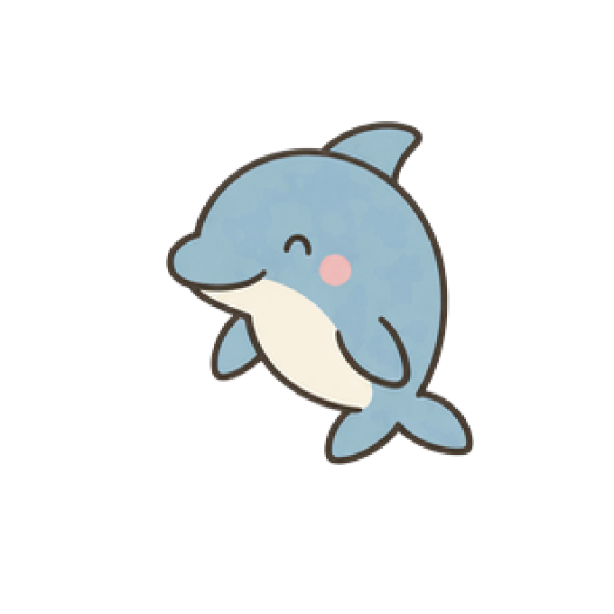

# Dolphin

[Collection](../../README.md) · [Installation](../../docs/INSTALLATION.md)

A cute little dolphin companion for Orca ADE.

## The joke

> Orcaにイルカはいるか？ 🐬
> 
> Is there a dolphin in Orca?

In Japanese, dolphin is イルカ (iruka), which sounds exactly like いるか？ (iru ka?) — meaning "Is it there?"

Put them together, and you get a playful question:

**"Orca ni iruka wa iru ka?"**

A dolphin in Orca? Absolutely! And it's ready to swim! 🐬❤️

**Some questions deserve a splashy answer.** ❤️

## Bundle

Import [dolphin.codex-pet/](dolphin.codex-pet/) using the [installation guide](../../docs/INSTALLATION.md).

| Property | Value |
| --- | --- |
| Pet ID | `dolphin` |
| Display name | Dolphin |
| Manifest | [pet.json](dolphin.codex-pet/pet.json) |
| Sprite atlas | [spritesheet.webp](dolphin.codex-pet/spritesheet.webp) |
| Frame size | 192 × 208 pixels |
| Default animation | `idle` |

The manifest defines nine animation states: `idle`, `running-right`, `running-left`, `waving`, `jumping`, `failed`, `waiting`, `running`, and `review`, with explicit frame durations. Keep the manifest and sprite atlas together inside the bundle directory.

## Project status

Part of Orca Dad Joke Pets, an unofficial community collection not affiliated with or endorsed by Orca ADE or its developers. Licensed under the [MIT License](../../LICENSE). Basic in-app checks have passed. Comprehensive testing of all animation states and platforms has not yet been completed.
