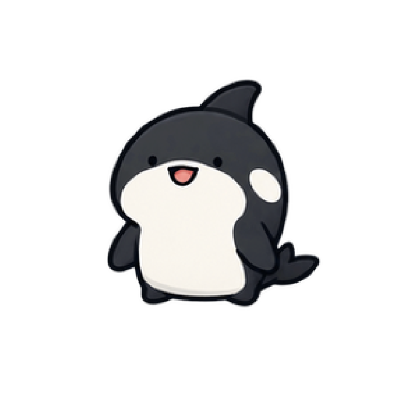

# Orca

[Collection](../../README.md) · [Installation](../../docs/INSTALLATION.md)

A cute little orca companion for Orca ADE.

## The joke

> Orcaにオルカはおるか？ 🐋
> 
> Is there an orca in Orca?

In Japanese, orca is written as オルカ (oruka), which sounds like おるか？ (oru ka?) — a casual, regional way of asking "Is it there?"

So the question becomes a playful tongue twister:

**"Orca ni orca wa oru ka?"**

An orca in Orca? Of course! It's right here! 🐋❤️

**Some questions have adorable answers.** ❤️

## Bundle

Import [orca.codex-pet/](orca.codex-pet/) using the [installation guide](../../docs/INSTALLATION.md).

| Property | Value |
| --- | --- |
| Pet ID | `orca` |
| Display name | Orca |
| Manifest | [pet.json](orca.codex-pet/pet.json) |
| Sprite atlas | [spritesheet.webp](orca.codex-pet/spritesheet.webp) |
| Frame size | 192 × 208 pixels |
| Default animation | `idle` |

The manifest defines nine animation states: `idle`, `running-right`, `running-left`, `waving`, `jumping`, `failed`, `waiting`, `running`, and `review`, with explicit frame durations. Keep the manifest and sprite atlas together inside the bundle directory.

## Project status

Part of Orca Dad Joke Pets, an unofficial community collection not affiliated with or endorsed by Orca ADE or its developers. Licensing is undecided. Installation and animation behavior have not been tested in Orca ADE during this documentation phase.
